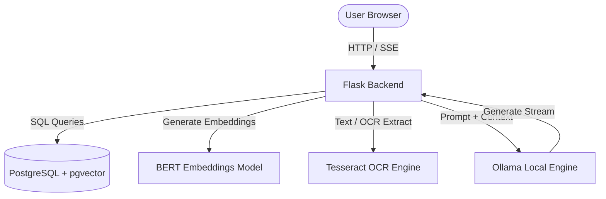

# Project Handbook: Advanced RAG Chatbot with User Authentication & Document Filtering

This document provides a deep-dive explanation of the project's architecture, core functionalities, database schemas, and how to run/use the system.

---

## 1. System Architecture Overview

The application is built on a modern **RAG (Retrieval-Augmented Generation)** stack that runs entirely on your local machine:



*   **Frontend:** Vanilla HTML5, modern HSL-tailored dark-mode CSS (glassmorphism styling), and JavaScript. Uses **Server-Sent Events (SSE)** via `EventSource` for real-time, token-by-token response streaming.
*   **Backend:** Flask Web API (Python 3.10+) serving endpoints for authentication, file uploads, chat session management, and querying.
*   **Database:** PostgreSQL with the `pgvector` extension.
    *   Stores user profiles and chat history.
    *   Stores document text chunks alongside their 384-dimensional vector embeddings.
*   **LLM Engine:** Ollama running `llama3:latest` (8B parameter model).
*   **Embeddings Model:** HuggingFace `sentence-transformers/all-MiniLM-L6-v2` (BERT-based, generating 384-dimensional dense vectors).

---

## 2. Core Functionalities (Deep Dive)

### A. User Authentication & Scoping
*   **How it works:** When a user accesses the page, a session check endpoint (`GET /user`) verifies if they have an active session cookie. If not, they are shown a centered, blur-filtered Login/Registration overlay.
*   **Security:** Passwords are never stored in plain text. They are hashed using the PBKDF2 algorithm via Python’s `werkzeug.security` module.
*   **File Isolation:** When files are uploaded, a record is added to the `user_files` table mapping the `user_id` to the `filename`. A user can only see, select, and count chunks for files they uploaded.

### B. Dynamic Document Ingestion Pipeline
When a user uploads a document:
1.  **Extraction:**
    *   *Normal PDFs:* Extracted via LangChain's unstructured PDF element loader.
    *   *Scanned/Image PDFs:* Automatically detected (characters < 100). The backend uses `pdf2image` (via Poppler) to render pages and extracts text using Tesseract OCR.
    *   *Images (.png, .jpg, .jpeg):* Opened using Pillow (`PIL`) and run directly through Tesseract OCR.
    *   *Word Docs & Text:* Loaded via `Docx2txtLoader` and standard text loaders.
2.  **Chunking:** The extracted text is split into small pieces using the `RecursiveCharacterTextSplitter` with `CHUNK_SIZE = 512` characters and `CHUNK_OVERLAP = 64` characters to preserve sentences and context boundary data.
3.  **Embedding:** The chunks are passed to the HuggingFace BERT embeddings model, converting each chunk into a vector.
4.  **Database Storage:** The chunks, metadata (source file name, page number, loader type), and vectors are stored in the PostgreSQL table `langchain_pg_embedding`.

### C. ChatGPT-Style Chat Sessions (History & Auto-Titling)
*   **New Chat:** Clicking the button creates a row in the `conversations` table with the title `"New Chat"`.
*   **Auto-Titling:** When the first message is sent, the backend dynamically updates the title of that conversation in PostgreSQL using the first 35 characters of the user's question. The sidebar list refreshes instantly.
*   **Context Loading:** When a message is sent, the server fetches the last 10 messages from the `messages` table for that `conversation_id` and pre-loads them into the RAG Agent's `ConversationBufferWindowMemory` before asking the LLM, preserving conversational memory across reloads.

### D. Checked Document Filtering (RAG Scoping)
*   Instead of querying your entire database, you select specific document checkboxes in the sidebar.
*   The frontend compiles this into a comma-separated list of filenames (e.g., `files=notes.txt,report.pdf`) and sends it with the query.
*   The vector database performs **metadata filtering** using PostgreSQL JSONB operators:
    ```python
    filter = {"filename": {"$in": ["notes.txt", "report.pdf"]}}
    ```
    This guarantees that the AI *only* retrieves information from the files you checked.
*   If no files are selected, the app reminds you to select at least one document.

### E. Smart Greetings Bypass
*   If you type simple greetings (like *"hi"*, *"hello"*, *"how are you"*), the RAG Agent detects it and bypasses database document search.
*   This prevents Llama 3 from getting confused by irrelevant document snippets when you are just making casual conversation.

---

## 3. Database Schema

Here are the tables created in your PostgreSQL database (`ragdb`):

### `users` (User accounts)
| Column | Type | Description |
| :--- | :--- | :--- |
| `id` | SERIAL (PK) | Unique user ID |
| `username` | VARCHAR(100) | Unique username |
| `password_hash`| VARCHAR(256) | Hashed password |
| `created_at` | TIMESTAMP | Creation timestamp |

### `user_files` (User document ownership mapping)
| Column | Type | Description |
| :--- | :--- | :--- |
| `id` | SERIAL (PK) | Unique mapping ID |
| `user_id` | INT (FK) | Reference to `users.id` |
| `filename` | VARCHAR(255) | Name of the file |
| `created_at` | TIMESTAMP | Upload timestamp |

### `conversations` (Chat sessions)
| Column | Type | Description |
| :--- | :--- | :--- |
| `id` | SERIAL (PK) | Session ID |
| `user_id` | INT (FK) | Reference to `users.id` |
| `title` | VARCHAR(255) | Title (e.g. "What is RAG?") |
| `created_at` | TIMESTAMP | Creation timestamp |

### `messages` (Chat messages history)
| Column | Type | Description |
| :--- | :--- | :--- |
| `id` | SERIAL (PK) | Message ID |
| `conversation_id`| INT (FK) | Reference to `conversations.id` |
| `role` | VARCHAR(50) | `'human'` or `'ai'` |
| `content` | TEXT | Message body text |
| `created_at` | TIMESTAMP | Message timestamp |

---

## 4. How to Use (Step-by-Step)

### Step 1: Run the Database & Ollama
1.  Ensure **PostgreSQL** is running on your machine.
2.  Ensure **Ollama** is running and the Llama 3 model is pulled:
    ```cmd
    ollama run llama3:latest
    ```

### Step 2: Configure Environment Variables
Verify your variables in `backend/.env`:
```ini
PG_HOST=localhost
PG_PORT=5432
PG_DB=ragdb
PG_USER=postgres
PG_PASSWORD=root
OLLAMA_MODEL=llama3:latest
OLLAMA_BASE_URL=http://localhost:11434
```

### Step 3: Run the Server
In your terminal, navigate to the folder and run:
```cmd
python backend/main.py
```
*(or run `run_backend.bat`)*

### Step 4: Using the Chat Interface
1.  Open **`http://localhost:8000`** in your browser.
2.  **Register / Log In:** Type in a username and password to create an account.
3.  **Upload Documents:** Drag and drop (or click to select) files like PDFs, Word files, text files, or images in the sidebar. Wait for the green success message.
4.  **Select & Check:** Check the files you want to ask questions about.
5.  **Chat:** Type a question (e.g. *"give me a summary of this document"*). Watch the response stream back. Click on **"source citations"** to see which document parts were queried.
6.  **Create New Chats:** Click **➕ New Chat** to clear the board and start a new conversation topic. Click on any previous session in the sidebar to switch back and reload its chat history.
