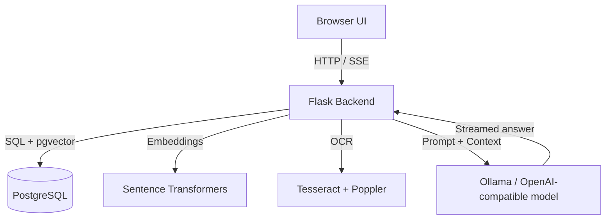

# DocMind AI

DocMind AI is a local-first Retrieval-Augmented Generation (RAG) chatbot that lets users upload documents, select exactly which files to query, and get streamed answers with source citations. It includes secure authentication, per-user document scoping, OCR support, conversation history, and Docker-based deployment.

## Why this project stands out

- Built for real-world document Q&A, not just a demo prompt.
- Supports PDF, DOCX, DOC, TXT, PNG, JPG, and JPEG uploads.
- Automatically extracts text from scanned files using OCR.
- Uses PostgreSQL + pgvector for semantic search.
- Streams responses with Server-Sent Events for a polished chat experience.
- Keeps documents and conversations isolated per user account.
- Runs fully locally with Docker, so it is easy to showcase in interviews.

## Live-feel features

- User registration and login with hashed passwords.
- Document upload, file selection, and scoped retrieval.
- Chat history with persistent conversation threads.
- Auto-titled chats based on the first question.
- Source citations from retrieved chunks.
- Greeting handling so casual small talk does not trigger retrieval.
- Optional OpenAI-compatible fallback, with Ollama as the local default.

## Tech Stack

- Frontend: HTML, Tailwind CSS, vanilla JavaScript
- Backend: Flask, Gunicorn, Flask-CORS
- Database: PostgreSQL, pgvector
- Embeddings: sentence-transformers/all-MiniLM-L6-v2
- LLM runtime: Ollama
- OCR: Tesseract, Poppler, Pillow, pdf2image
- Document parsing: LangChain loaders, python-docx, unstructured, pdfminer
- Containerization: Docker, Docker Compose, Nginx

## Architecture



## Project Structure

```text
.
|-- backend/
|   |-- main.py
|   |-- retriever.py
|   |-- ingest.py
|   |-- templates/
|   |   |-- index.html
|   |   `-- components/
|   |-- .env.example
|-- docker-compose.yml
|-- Dockerfile
|-- nginx/
|-- postgres/
|-- requirements.txt
|-- README.md
|-- SETUP_WINDOWS.md
`-- PROJECT_EXPLANATION.md
```

## Core Capabilities

### Authentication and privacy

- Users register and sign in securely.
- Passwords are hashed with Werkzeug.
- Files and chat records are scoped to the signed-in user.

### Document ingestion

- Extracts text from text-based files and office documents.
- Detects image-based PDFs and runs OCR automatically.
- Splits content into chunks before embedding.
- Stores embeddings in PostgreSQL with pgvector.

### Selective retrieval

- Users can check which uploaded files should be used for a question.
- Retrieval is filtered to the selected file list.
- This keeps answers focused and easier to explain in interviews.

### Streaming chat experience

- Responses are streamed token-by-token using SSE.
- Conversation history is stored in the database.
- The sidebar shows previous chats and uploaded files.

## Requirements

For local development without Docker:

- Python 3.10 or 3.11
- PostgreSQL 16 or compatible
- pgvector extension enabled
- Ollama installed and running
- Tesseract OCR installed
- Poppler installed for PDF-to-image conversion

## Environment Setup

Copy `backend/.env.example` to `backend/.env` and update the values:

```ini
PG_HOST=localhost
PG_PORT=5432
PG_DB=ragdb
PG_USER=postgres
PG_PASSWORD=your_postgres_password

OLLAMA_MODEL=llama3:latest
OLLAMA_BASE_URL=http://localhost:11434

TESSERACT_CMD=C:\Program Files\Tesseract-OCR\tesseract.exe
POPPLER_PATH=C:\poppler\Library\bin

TOP_K=5
MEMORY_WINDOW=5
FLASK_SECRET_KEY=change-this-in-production
```

## Run With Docker

This is the easiest way to demo the project.

1. Make sure Docker Desktop is running.
2. Put your values in `backend/.env`.
3. Start the stack:

```bash
docker compose up --build
```

4. Open the app:

- Web UI through Nginx: `http://localhost`
- Flask app directly: `http://localhost:8000`

The Docker stack includes:

- PostgreSQL with `pgvector`
- Ollama
- Flask backend
- Nginx reverse proxy

## Run Locally Without Docker

1. Create and activate a Python virtual environment.
2. Install dependencies:

```bash
pip install -r requirements.txt
```

3. Set up PostgreSQL and enable pgvector:

```sql
CREATE EXTENSION IF NOT EXISTS vector;
```

4. Start Ollama and pull a model:

```bash
ollama pull llama3:latest
```

5. Run the backend:

```bash
python backend/main.py
```

6. Open:

```text
http://localhost:8000
```

## How To Use The App

1. Register or sign in.
2. Upload one or more documents from the sidebar.
3. Wait for ingestion to complete.
4. Select the files you want the model to use.
5. Ask a question in the chat box.
6. Review the streamed answer and source citations.
7. Start a new conversation whenever you want a fresh thread.

## What To Upload To GitHub

Upload the source code and project files only:

- `backend/`
- `backend/.env.example`
- `docker-compose.yml`
- `Dockerfile`
- `.gitignore`
- `.dockerignore`
- `nginx/`
- `postgres/`
- `requirements.txt`
- `README.md`
- `SETUP_WINDOWS.md`
- `PROJECT_EXPLANATION.md`
- `run_backend.bat`
- `setup_windows.bat`
- `install_pgvector.ps1`

Do not upload secrets, local environments, or generated data:

- `backend/.env`
- `rag_env/`
- `backend/uploads/`
- `__pycache__/`
- any model weights, checkpoints, or large binary artifacts

## GitHub Upload Steps

If the folder is not already a Git repository, initialize it first.

```bash
git init
git add .
git commit -m "Initial commit: DocMind AI"
git branch -M main
git remote add origin https://github.com/<your-username>/<your-repo>.git
git push -u origin main
```

If the repo already exists on GitHub, just update it:

```bash
git add .
git commit -m "Polish README and project setup"
git push
```

## Troubleshooting

- If OCR fails, confirm Tesseract and Poppler paths in `backend/.env`.
- If embeddings or vector search fail, verify PostgreSQL and `pgvector`.
- If Ollama is unreachable, make sure the service is running and the model is pulled.
- If uploads do not appear, check the `backend/uploads/` directory permissions.

## Files Worth Highlighting In Interviews

- [`backend/main.py`](backend/main.py) - authentication, chat streaming, and conversation storage
- [`backend/retriever.py`](backend/retriever.py) - retrieval and model orchestration
- [`backend/ingest.py`](backend/ingest.py) - OCR, chunking, and vector storage
- [`backend/templates/index.html`](backend/templates/index.html) - app shell and styling
- [`backend/templates/components/scripts.html`](backend/templates/components/scripts.html) - client-side state and streaming UI
- [`docker-compose.yml`](docker-compose.yml) - full local deployment stack

## Suggested Resume Summary

DocMind AI is a full-stack RAG document assistant with authentication, OCR ingestion, pgvector retrieval, conversation memory, and Dockerized deployment. It is designed for private, local document analysis and interview demonstrations.

